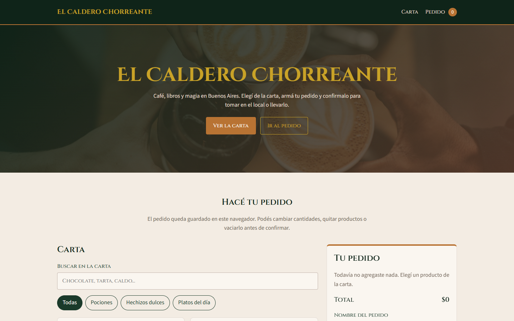
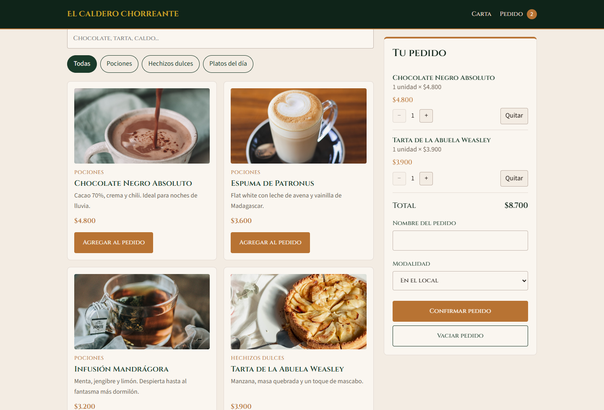

# El Caldero Chorreante — Pedido

Simulador de pedido para el café-librería ficticio El Caldero Chorreante. Entrega final de JavaScript (Coderhouse).

El circuito es: ver la carta, elegir productos, modificar cantidades, calcular el total y confirmar el pedido.

## Capturas





## Cómo abrirlo

La carta se lee desde `data/productos.json` con `fetch`. Eso no funciona si abrís `index.html` con doble clic. Hay que servir la carpeta con un servidor local.

**Opción 1.** En Cursor o VS Code, instalá la extensión Live Server, abrí `index.html` y elegí "Open with Live Server".

**Opción 2.** En esta carpeta, ejecutá:

```bash
npx serve .
```

Abrí la dirección que muestra la terminal.

## Estructura

```
index.html
readme.md
assets/images/
data/productos.json
js/pedido.js
js/carta.js
styles/estilos.css
```
